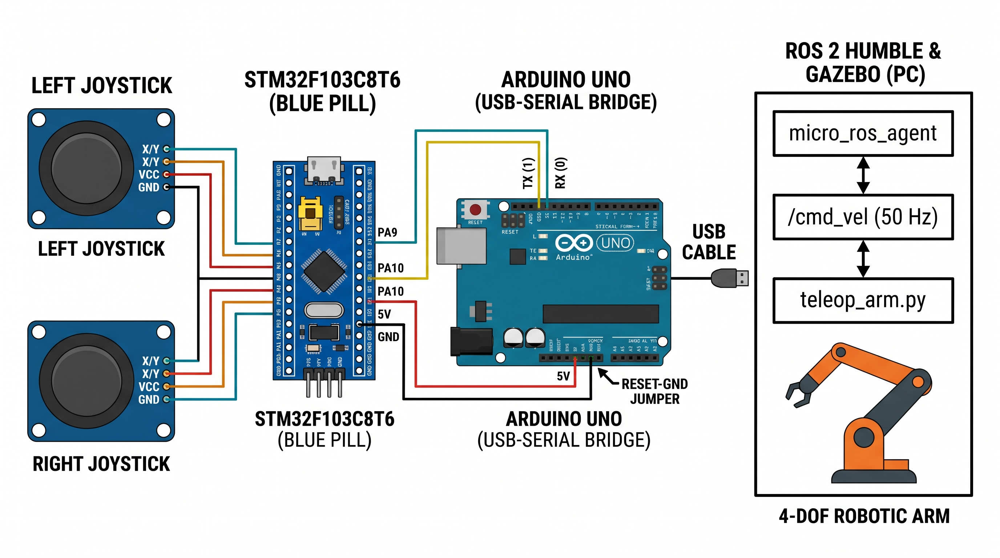

# 4-DOF Pick & Place Robot Kolu ve micro-ROS Teleoperasyon Sistemi

ROS 2 Humble, Gazebo ve STM32 Blue Pill (`STM32F103C8T6`) kullanılarak geliştirilmiş, çift analog joystick kontrollü 4 serbestlik dereceli (4-DOF) endüstriyel Pick & Place robot kolu simülasyonu.

## Sistem Mimarisi
- **Simülasyon:** ROS 2 Humble, Gazebo Classic, URDF/Xacro (`advanced_arm`)
- **Mikrodenetleyici:** STM32F103C8T6 (PlatformIO + `micro_ros_arduino`, 50 Hz `/cmd_vel` yayını)
- **Kontrol Özellikleri:**
  - 4 döner eklem (`joint_1`–`joint_4`) ve senkronize prizmatik kıskaç
  - İleri kinematik tabanlı Z-ekseni sanal tezgah çarpışma koruması
  - 16 cm yakalama yarıçaplı manyetik nesne kilitleme ve bilek rotasyonu senkronizasyonu
  - Hassas Nişan / Seri Taşıma hız modları ve yumuşak Home dönüşü

## Kurulum ve Çalıştırma

### 1. ROS 2 Paketini Derleme
~~~bash
mkdir -p ~/ros2_ws/src
cp -r ros2_ws/src/joystick_arm ~/ros2_ws/src/
cp ros2_ws/spawn_pick_place.py ~/ros2_ws/
cd ~/ros2_ws && colcon build --symlink-install
~~~

### 2. Simülasyon ve Donanım Bağlantısı
1. **micro-ROS Ajanı:**
~~~bash
sudo chmod 666 /dev/ttyUSB0
ros2 run micro_ros_agent micro_ros_agent serial --dev /dev/ttyUSB0
~~~
2. **Gazebo Simülasyonu:**
~~~bash
source ~/ros2_ws/install/setup.bash
ros2 launch joystick_arm sim.launch.py
~~~
3. **Tezgah ve Küpler:**
~~~bash
python3 ~/ros2_ws/spawn_pick_place.py
~~~

## Donanım ve Sistem Mimarisi Şeması

### Pin Bağlantı Tablosu (Arduino Uno Köprü Modu)
| STM32 Blue Pill | Arduino Uno | Açıklama |
| :--- | :--- | :--- |
| `5V` | `5V` | Güç beslemesi |
| `GND` | `GND` | Ortak toprak hattı |
| `PA9` (TX1) | `TX (Pin 1)` | UART veri hattı (Düz bağlantı) |
| `PA10` (RX1) | `RX (Pin 0)` | UART veri hattı (Düz bağlantı) |
| — | `RESET` ↔ `GND` | Arduino işlemcisini devre dışı bırakma köprüsü |
